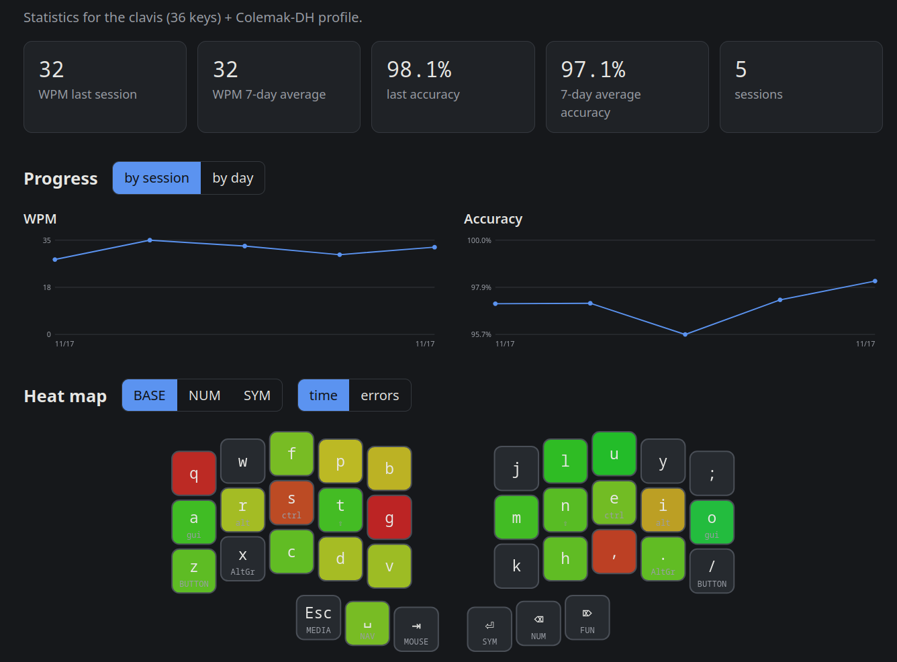

# clavis-trainer

A typing trainer for the [clavis](https://github.com/scipioni/clavis) split
keyboard (36 keys, Miryoku Colemak-DH with home row mods) and for standard
ANSI and ISO keyboards, with Colemak-DH, US QWERTY or Italian QWERTY layouts.
Adaptive drills that target your weak spots, real Italian or English text, and
statistics over time, kept separately for each keyboard and layout. Training
runs entirely in the browser (IndexedDB); signing in with Telegram is optional
and makes your history follow you across devices.


## Features

- **Three modes**: adaptive (words and drills built from your weakest
  characters, bigrams, layer transitions and dead keys), sentences, and free
  text.
- **Keyboard guide**: shows which key to tap, which key to hold (Shift on the
  opposite home row mod, layer keys) and the dead key sequence for accented
  letters.
- **Clean timings**: the cursor stops on an error (no Backspace), so per-character
  times are not polluted by corrections. Accidental modifiers from home row
  mod rolls are counted separately.
- **Statistics**: WPM and accuracy trends, a per-layer heat map, and rankings of
  weak units with a "train this" button.

  <picture>
    <source media="(prefers-color-scheme: dark)" srcset="docs/stats-dark.png">
    
  </picture>

- **Local first**: everything works offline and without an account; export,
  import and reset from the settings page.
- **Telegram sign-in and sync** (optional): the site shows a code, the bot shows
  the same code with a Confirm button. Completed sessions and settings are then
  synced between your devices; history recorded before signing in is merged
  into the account.

- **Profiles**: keyboard (clavis, standard ANSI, standard ISO) and layout
  (Colemak-DH, US QWERTY, Italian QWERTY) are chosen independently. Each
  combination has its own statistics, and the app lists the characters the
  profile cannot type (for example `È` with the Italian layout).
- **Two languages**: the interface is in Italian or English (from the browser
  language at first, then a setting), and the exercise language is chosen
  separately.

### Profiles and layouts

Characters are resolved through keycodes: each physical key emits a keycode
(`KeyboardEvent.code` names) and an operating system map turns keycodes into
characters at four levels (plain, Shift, AltGr, AltGr+Shift). The same clavis
keymap therefore works with the system set to US or Italian.

| Keyboard | Layout | Keys | System map |
|---|---|---|---|
| clavis | Colemak-DH | firmware (Colemak-DH base) | US / US International |
| clavis | US QWERTY | firmware with the Miryoku QWERTY base | US / US International |
| clavis | Italian QWERTY | firmware with the Miryoku QWERTY base | Italian |
| ANSI / ISO | Colemak-DH | standard positions | Colemak-DH with angle mod |
| ANSI / ISO | US QWERTY | standard positions | US / US International |
| ANSI / ISO | Italian QWERTY | standard positions | Italian |

System maps are in `src/core/keyboard/osmaps.ts` (from the XKB `us`,
`us(colemak_dh)`, `us(colemak_dh_iso)` and `it` files), keyboards in
`src/core/keyboard/boards.ts`. The Italian map follows Linux: on Windows `` ` ``
and `~` are not available. With clavis + QWERTY the firmware has no `;` key,
so `;` (and `ò` with the Italian layout) cannot be typed.

## Commands

```sh
bun install          # dependencies
bun run dev          # development server on http://localhost:5173
bun run build        # static build in dist/
bun run preview      # serve dist/
bun run server       # API and bot on :8080 (Vite proxies /api to it)
bun run test         # client unit tests (Vitest)
bun run test:server  # server tests (bun test)
bun run check        # type checking (svelte-check + tsc for server/) and untranslated UI text
```

The server (`server/`) is a single Bun process: static files, the JSON API under
`/api/` and the Telegram login bot (long polling), with SQLite (`bun:sqlite`)
in `DATA_DIR`. Without `TELEGRAM_BOT_TOKEN` the sign-in button is hidden and
the app behaves as a purely local one. See the header of `server/main.ts` for
all environment variables.

## clavis keymap

The keyboard model is generated from the ZMK keymap in
[scipioni/clavis](https://github.com/scipioni/clavis)
(`firmware/zmk-timeless/config/custom_config.h`, macros
`MIRYOKU_LAYER_BASE/NUM/SYM`). The local checkout of that repository is
`/lab/clavis`, next to this one, so a firmware change can be tried here before
it is pushed. After a firmware change:

```sh
bun run gen:keymap                          # download from GitHub (main branch)
bun run gen:keymap /lab/clavis/firmware/zmk-timeless/config/custom_config.h   # from the local checkout
```

The script rewrites `src/core/keyboard/clavis.keymap.json`. Also update the test
fixture (`tests/fixtures/custom_config.h`) with the same file, then run
`bun run test`. Fingers are assigned by column (pinky, ring, middle, index for
the two inner columns, thumb) in `src/core/keyboard/geometry.ts`; the US
International dead key compositions are in `src/core/keyboard/deadKeys.ts`.

## Corpus

Words (FrequencyWords, CC BY-SA 4.0) and sentences (Tatoeba, CC BY 2.0 FR) for
Italian and English are already in `public/corpus/it/` and `public/corpus/en/`.
To regenerate them, run `bun run build:corpus` (or `bun run build:corpus it|en`).
It downloads the sources into `.corpus-raw/` and needs `bunzip2`. Words to
exclude are listed in `scripts/corpus-exclude-it.txt` and
`scripts/corpus-exclude-en.txt`. FrequencyWords splits English contractions
(`don't` → `don` + `t`): the script drops the fragments and rebuilds the
contractions from the Tatoeba sentences. Sources and licenses:
[ATTRIBUTION.md](ATTRIBUTION.md).

## Interface languages

All UI text goes through `t()` (`src/i18n/`): `it.ts` is the reference catalog,
`en.ts` must have the same keys (checked by the type system and by a unit
test). `bun scripts/check-i18n.ts` (part of `bun run check`) fails if a
component contains visible text outside the catalog.

## UI tests

`tests/e2e/smoke.ts` drives the app in Chromium (through `playwright-core`) and
simulates dead keys with composition events. It covers free text with accents
and apostrophes, accidental modifiers, abandoning a session, a 30 s session
checked against the core's own computation, settings after a reload, importing
`tests/fixtures/example-export.json`, rankings and targeted training.

```sh
bun run build && bun run preview --port 4173 &
bun tests/e2e/smoke.ts            # CHROMIUM=/path/to/chromium for another browser
```

`tests/e2e/account.ts` covers sign-in and sync with a fake bot
(`TELEGRAM_FAKE=1`), using three browser contexts as three devices: confirm and
deny in the bot, a session made on one device appearing on another, settings
following the account, anonymous history merged on sign-in, sign-out.

```sh
task server:e2e &                 # server with the fake bot on :8099
bun tests/e2e/account.ts http://localhost:8099/
bun tests/e2e/profiles.ts http://localhost:8099/
task e2e                          # all suites against the local Docker image
```

`tests/e2e/profiles.ts` starts with an English browser (interface and exercises
in English), switches the interface language without reloading, draws the
three keyboards with the Italian layout (screenshots in `tests/e2e/out/`),
checks the unreachable-character warning and that two profiles keep separate
statistics.

They do not replace testing with a real clavis: dead key composition and home
row mods depend on the operating system and the firmware.

## Production

The app runs on `cubo` at <https://clavis.mywire.org>, behind the Traefik of
the passbolt stack (network `passbolt_default`, Let's Encrypt certificate). The
image is public on Docker Hub: `scipioit/clavis-trainer`.

**How a release ships**

1. A push to `main` that touches the application (`src/`, `server/`,
   `public/`, dependencies, `Dockerfile`) runs `.github/workflows/release.yml`:
   it builds the image (client and server tests run inside the build) and
   publishes it as `sha-<commit>` and `latest`. Changes to docs, specs or tests
   only do not produce a release.
2. On cubo, `~/clavis-trainer/update.sh` runs from crontab every 5 minutes. It
   recreates the container when the image or the configuration (`.env`)
   changed, and logs one line to `~/clavis-trainer/update.log`.

Versioned releases: tag the commit `vX.Y.Z` (and set the same version in
`package.json`). Pushing the tag makes the workflow publish `X.Y.Z` too;
`task docker:publish` on a tagged commit does the same by hand. Production
keeps following `latest`.

Releases are small. The Bun base image is downloaded once; corpus, site and
server are reproducible layers (the Dockerfile zeroes all mtimes), so a release
only ships the layers that changed: typically the site (about 160 kB) and the
server bundle (about 30 kB). Static files are pre-compressed with `gzip -n`;
`index.html` is never cached, hashed assets and the corpus
(`?v=<content hash>`) are immutable.

The workflow needs the `DOCKERHUB_USERNAME` and `DOCKERHUB_TOKEN` secrets (a
Docker Hub access token with Read & Write):

```sh
gh secret set DOCKERHUB_USERNAME --body scipioit
gh secret set DOCKERHUB_TOKEN    # paste the token when asked
```

Without them the workflow skips the release with a warning.

**Telegram bot**

Create a bot with [@BotFather](https://t.me/BotFather) (`/newbot`) and put its
token in `~/clavis-trainer/.env` on cubo:

```sh
ssh scipio@cubo.local 'echo "TELEGRAM_BOT_TOKEN=123456:ABC..." >> ~/clavis-trainer/.env'
```

Within 5 minutes the cron recreates the container and the sign-in button
appears. The server sets the bot's name, descriptions and `/start` command by
itself. No `/setdomain` is needed: sign-in uses a `t.me/<bot>?start=<id>` deep
link plus a code that the user confirms in the bot.

**Data and backups**

Accounts and history live in `~/clavis-trainer/data/clavis.db` (SQLite, WAL)
on cubo. Include that directory in cubo's backups; for a consistent copy while
the app runs use `sqlite3 data/clavis.db ".backup /path/clavis.db"`.

**Rolling back the client**

Since the profiles release the browser database is IndexedDB version 2
(statistics per profile). An older build cannot open a version 2 database, so
after rolling back to `sha-fb5b74f` or earlier users must clear the site data;
history comes back from the account (if signed in) or from a JSON export.
Server data needs no migration in either direction.

**Commands** ([Task](https://taskfile.dev))

```sh
task docker:run        # local image on http://localhost:8088 (fake bot)
task e2e               # smoke + account tests against the local image
task docker:publish    # manual release from here (clean tree only)
task deploy:install    # first install on cubo: compose, script, cron
task deploy:files      # push new compose/update.sh to cubo (keeps .env and data/)
task deploy:now        # update now instead of waiting for cron
task deploy:rollback -- sha-abc1234   # pin a version (CLAVIS_TAG in .env)
task deploy:latest     # follow latest again
```
