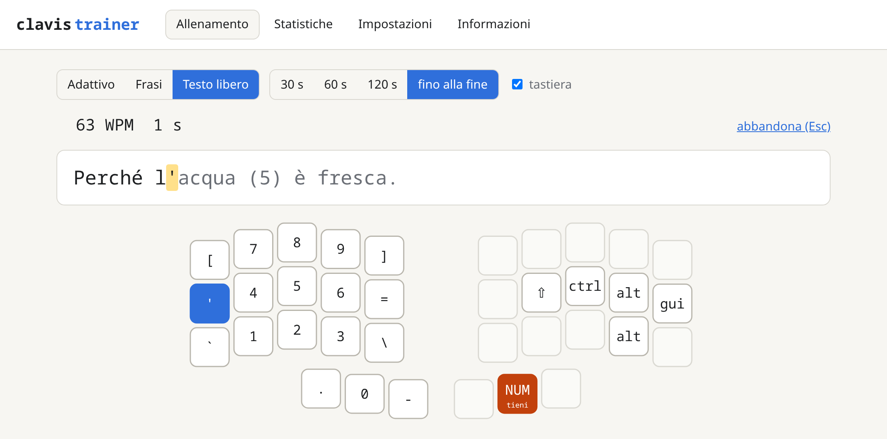

# clavis-trainer

A typing trainer for the [clavis](https://github.com/scipioni/clavis) split
keyboard (36 keys, Miryoku Colemak-DH with home row mods), used with the
system layout set to US International with dead keys. Adaptive drills that
target your weak spots, real Italian text, and statistics over time. Everything
runs in the browser with no server: your data stays in IndexedDB.



## Features

- **Three modes**: adaptive (words and drills built from your weakest
  characters, bigrams, layer transitions and dead keys), sentences, and free
  text.
- **Keyboard guide**: shows which key to tap, which key to hold (Shift on the
  opposite home row mod, layer keys) and the dead key sequence for accented
  letters.
- **Clean timings**: the cursor stops on an error (no Backspace), so per-character
  times are not polluted by corrections. Accidental modifiers from home row
  mod rolls are counted separately.
- **Statistics**: WPM and accuracy trends, a per-layer heat map, and rankings of
  weak units with a "train this" button.
- **Local data**: export, import and reset from the settings page.

The interface is in Italian.

## Commands

```sh
bun install          # dependencies
bun run dev          # development server on http://localhost:5173
bun run build        # static build in dist/
bun run preview      # serve dist/
bun run test         # unit tests (Vitest)
bun run check        # type checking (svelte-check)
```

## clavis keymap

The keyboard model is generated from the ZMK keymap in
[scipioni/clavis](https://github.com/scipioni/clavis)
(`firmware/zmk-timeless/config/custom_config.h`, macros
`MIRYOKU_LAYER_BASE/NUM/SYM`). After a firmware change:

```sh
bun run gen:keymap                          # download from GitHub (main branch)
bun run gen:keymap ../clavis/firmware/zmk-timeless/config/custom_config.h   # from a local copy
```

The script rewrites `src/core/keyboard/clavis.keymap.json`. Also update the test
fixture (`tests/fixtures/custom_config.h`) with the same file, then run
`bun run test`. Fingers are assigned by column (pinky, ring, middle, index for
the two inner columns, thumb) in `src/core/keyboard/geometry.ts`; the US
International dead key compositions are in `src/core/keyboard/deadKeys.ts`.

## Corpus

Words (FrequencyWords, CC BY-SA 4.0) and sentences (Tatoeba, CC BY 2.0 FR) are
already in `public/corpus/`. To regenerate them, run `bun run build:corpus`. It
downloads the sources into `.corpus-raw/` and needs `bunzip2`. Words to exclude
are listed in `scripts/corpus-exclude.txt`. Sources and licenses:
[ATTRIBUTION.md](ATTRIBUTION.md).

## UI tests

`tests/e2e/smoke.ts` drives the app in Chromium (through `playwright-core`) and
simulates dead keys with composition events. It covers free text with accents
and apostrophes, accidental modifiers, abandoning a session, a 30 s session
checked against the core's own computation, settings after a reload, importing
`tests/fixtures/example-export.json`, rankings and targeted training.

```sh
bun run build && bun run preview --port 4173 &
bun tests/e2e/smoke.ts            # CHROMIUM=/path/to/chromium for another browser
```

It does not replace testing with a real clavis: dead key composition and home
row mods depend on the operating system and the firmware.
